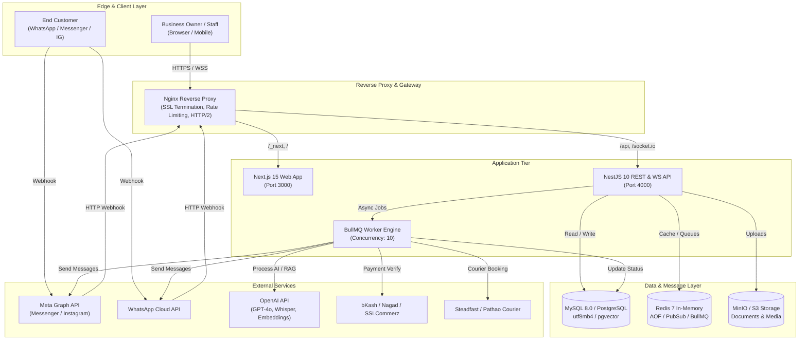

# OmniFlow — Multi-Tenant AI Business Automation SaaS


> **Commercial-Grade Omnichannel Customer Engagement, Autonomous AI Agents, E-Commerce Operations, and Automated Billing Infrastructure.**

OmniFlow empowers modern e-commerce enterprises, retail brands, and service businesses across Bangladesh and globally to centralize messaging, automate customer qualification, recognize visual products, execute real-time sales transactions, collect multi-gateway payments, and schedule courier logistics 24/7 without human intervention.

---

## 🌟 Key Capabilities

### 1. Unified Omnichannel Collaborative Team Inbox
- Connect **Facebook Messenger**, **Instagram Messaging**, and **WhatsApp Business Cloud API** under one single interface.
- 3-panel collaborative layout: Filterable conversation lists, full media message timelines, and contextual CRM details.
- Real-time bi-directional sync via **Socket.IO WebSockets** with typing indicators, delivery ticks, and unread badges.
- Smooth **AI-to-Human Handover** with automatic timer expirations, reassignment rules, and internal staff notes.

### 2. Autonomous Multi-Modal AI Agent Engine
- **OpenAI GPT-4o** conversational intelligence with configurable tone, persona, working hours, and response languages (English, Bengali, and Banglish).
- **Computer Vision**: Instant product recognition from customer photo submissions with automatic stock and price matching.
- **Audio Transcription**: Automated voice message transcription powered by OpenAI Whisper STT.
- **RAG Knowledge Base**: High-dimensional semantic embeddings with vector search across PDFs, DOCX, CSVs, manual FAQs, and website links.
- Real-time Interactive **AI Testing Playground** with instant variable inspection.

### 3. Full-Lifecycle Business Operations
- **Product & Inventory Management**: Multi-variant tracking (Size, Color, SKU), stock transactions, barcode lookups, low-stock alerts, and bulk CSV import/export.
- **Customer CRM**: 360° customer profiles, behavioral tags, lifetime spending analytics, interaction timelines, and customer segmentation.
- **Omnichannel Order Processing**: Automated order drafting, delivery calculations, coupon discounts, invoice PDF generation, and printable thermal packing slips.
- **Visual Lead Pipeline**: Drag-and-drop Kanban board with lead scoring, deal values, and automated stage conversion tracking.
- **Service Bookings**: Real-time calendar availability, appointment scheduling, and automated WhatsApp/SMS reminder dispatches.

### 4. Visual Workflow Automation Engine
- Node-based graphical workflow builder with condition branching, custom delays, and automated webhooks.
- Event triggers: `INCOMING_MESSAGE`, `ORDER_CREATED`, `PAYMENT_RECEIVED`, `LEAD_STATUS_CHANGED`, `INACTIVITY`.
- Actions: Automated WhatsApp replies, staff assignment, CRM tagging, invoice dispatch, and external HTTP webhooks.
- Built-in dry-run sandbox with live visual execution history and automatic retries with exponential backoff.

### 5. Multi-Gateway Regional & International Payments
- Native integrations for **bKash Tokenized Checkout**, **Nagad Direct Gateway**, **SSLCommerz Hosted Session**, and **Stripe Elements**.
- Cryptographic signature verification, idempotent webhook processing, and atomic database ledgers.
- Automated payment link generation dispatched directly inside Messenger and WhatsApp conversations.

### 6. Automated Courier Logistics & Dispatch
- Direct API integration with **Steadfast Courier** and **Pathao Courier API v2**.
- Instant 1-click consignment creation, parcel tracking, COD (Cash-on-Delivery) collection reconciliation, and status sync.

### 7. SaaS Billing, Credit Wallets & Super-Admin Console
- **Credit Wallet System**: Token-based AI usage deductions, transaction ledgers, monthly tier limits, and low-balance warnings.
- **Root Super-Admin Console (`/admin`)**: Cross-tenant analytics, platform revenue graphs, tenant suspension/activation, user session revocation, and system health telemetry.

---

## 🏛️ System Architecture



---

## 💻 Tech Stack

| Domain | Technologies |
| :--- | :--- |
| **Frontend** | Next.js 15 (App Router), React 19, Tailwind CSS, Lucide React, TanStack Query, Socket.IO Client |
| **Backend API** | NestJS 10, Fastify/Express, TypeScript 5, Passport.js, JWT, Socket.IO Gateway |
| **Background Processing** | BullMQ 5, Redis 7 (In-Memory Pub/Sub & Queues) |
| **Database & ORM** | MySQL 8.0 / PostgreSQL 16 (`pgvector`), Prisma ORM 5 |
| **Object Storage** | MinIO / AWS S3 (AES-256 encrypted media and vector knowledge sources) |
| **AI & ML** | OpenAI GPT-4o, GPT-4o-mini, Whisper STT, text-embedding-3-small |
| **Reverse Proxy & Edge** | Nginx 1.25 Alpine, Let's Encrypt Certbot SSL |
| **Containers & CI/CD** | Docker Multi-Stage Builds, Docker Compose, GitHub Actions |

---

## 📁 Monorepo Structure

```
├── apps/
│   ├── web/               # Next.js 15 frontend application
│   ├── api/               # NestJS 10 core API server & WebSocket gateway
│   └── worker/            # BullMQ background async processor
├── packages/
│   ├── database/          # Prisma ORM schema, migrations, and seeders
│   ├── shared/            # Shared TypeScript interfaces, types, and Zod schemas
│   ├── ui/                # Reusable UI component library (Design Tokens + Tailwind)
│   └── integrations/      # Third-party client SDKs (Meta, OpenAI, bKash, Steadfast)
├── docker/                # Production & local Docker configs, Nginx reverse proxy
├── docs/                  # Architectural blueprints, security audits, and QA reports
├── .github/workflows/     # Automated CI/CD pipelines (Quality Gate & Deployment)
└── docker-compose.prod.yml# Production container orchestration
```

---

## 🚀 Quick Start (Local Development)

```bash
# 1. Clone repository
git clone https://github.com/omniflow-saas/omniflow.git
cd omniflow

# 2. Install dependencies
pnpm install

# 3. Start local MySQL, Redis, and MinIO
docker compose -f docker/docker-compose.yml up -d

# 4. Configure environment
cp .env.example .env

# 5. Push database schema & generate Prisma client
pnpm --filter @omniflow/database prisma db push
pnpm --filter @omniflow/database prisma generate

# 6. Run all monorepo services in parallel
pnpm dev
```

Visit `http://localhost:3000` to access the marketing portal and business dashboard.

---

## 📖 Production Guides & Documentation

- [Developer Installation Guide](INSTALLATION.md)
- [Production Deployment Runbook](DEPLOYMENT.md)
- [Environment Variables Catalog](ENVIRONMENT_VARIABLES.md)
- [Third-Party Integration Setup](INTEGRATION_SETUP.md)
- [Database Backup & Recovery Runbook](BACKUP_RECOVERY.md)
- [Super-Administrator Operating Guide](ADMIN_GUIDE.md)
- [Production Readiness Audit Report](docs/PRODUCTION_READINESS_REPORT.md)

---

## 🔒 Security & Compliance

- **Multi-Tenant Isolation**: Guaranteed via workspace-scoped Prisma filters (`where: { tenantId }`) and server-side RBAC guards.
- **Credential Protection**: All sensitive merchant keys, third-party access tokens, and webhook secrets are encrypted at rest using **AES-256-GCM**.
- **Financial Idempotency**: Atomic balance mutations and duplicate deduction prevention enforced via `idempotencyKey` constraints.
- **OWASP Hardened**: Content-Security-Policy, strict rate limiting on authentication routes, and parameterized database queries.

---

## 📄 License

Proprietary Commercial SaaS Software. All rights reserved.
