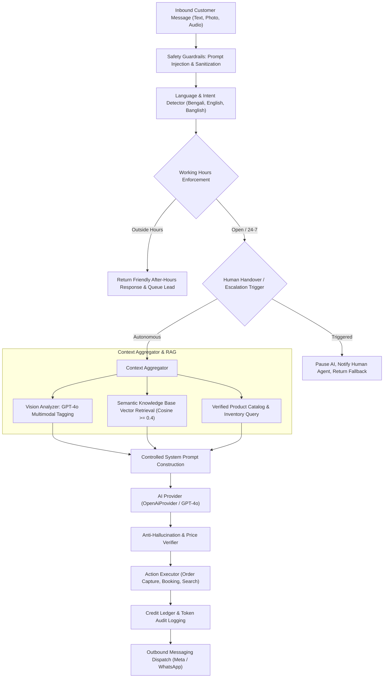

# OmniFlow SaaS — Production AI Agent Architecture & Pipeline Specification

## 1. Executive Summary

This document specifies the autonomous AI agent infrastructure for **OmniFlow SaaS**, supporting multi-tenant conversational sales and support operations for Bangladeshi and global e-commerce businesses across Facebook Messenger, Instagram, and WhatsApp Cloud APIs.

---

## 2. Architectural Components

---

## 3. Core Modules & Responsibilities

### 3.1 AI Provider Abstraction (`apps/api/src/ai-agent/providers/`)
- `AiProvider`: Pluggable interface defining `generateCompletion`, `generateEmbedding`, `analyzeImage`, and `transcribeAudio`.
- `OpenAiProvider`: Production implementation utilizing OpenAI `gpt-4o`, `text-embedding-3-small`, and `whisper-1` with automatic offline sandbox fallback.
- `AiProviderFactory`: Dynamically instantiates and resolves AI providers per tenant or system preferences.

### 3.2 Language & Intent Detection (`LanguageIntentDetector`)
- **Bengali (বাংলা)**: Detects native Bengali Unicode script (`\u0980-\u09FF`).
- **Banglish**: Phonetic detection of Latin-scripted Bengali (`bhai`, `koto`, `ache`, `dam`, `nibo`, `lagbe`, `shondor`, `apnader`, `dibo`).
- **English**: Lexical and stopword classification.
- **Intents**: `PRODUCT_INQUIRY`, `PRICE_CHECK`, `ORDER_CREATION`, `ORDER_STATUS`, `BOOKING_REQUEST`, `FAQ_POLICY`, `HUMAN_HANDOVER`, `GREETING`.

### 3.3 Safety Guardrails & Anti-Hallucination (`SafetyGuardrails`)
- **Prompt Injection Defense**: Evaluates incoming text against pattern attacks (`ignore previous instructions`, `reveal system prompt`, `developer mode`).
- **Price Verification**: Matches all prices mentioned in AI output (`৳`, `BDT`, `taka`) against the verified database products. Unauthorized or fabricated prices are flagged.
- **Capability Gating**: Enforces that operations like `autoOrderCreation` or `imageRecognition` are only allowed if enabled in workspace config.

### 3.4 Knowledge Base & Vector Retrieval (`KnowledgeService`)
- Multi-format ingestion: PDF, DOCX, TXT, CSV, Website URL, Manual FAQ, Business Instructions.
- Recursive chunking with paragraph/sentence boundary detection and 50-character sliding overlap.
- High-dimensional vector embeddings stored in database with source metadata.
- Cosine similarity ranking and threshold filtering.

### 3.5 AI Testing Playground (`/ai-agent`)
- Pre-activation sandbox with dual-pane layout.
- Real-time diagnostic telemetry: detected language and intent, similarity match scores, verified catalog items, planned actions, safety audit results, token and credit tracking.
- Test presets for Bengali, Banglish, English, voice notes, and image search.

---

## 4. Verification & Testing Standards

All critical AI capabilities are verified via automated Jest test suites (`test/ai-pipeline.spec.ts`):
1. **Retrieval Accuracy**: Semantic search scores and CSV/FAQ parsing.
2. **Permission Boundaries**: Action blocking on disabled capabilities.
3. **Response Validation**: Detection of hallucinated prices.
4. **Tool Execution**: Multimodal vision, voice transcription, and human escalation.
5. **Language & Banglish Detection**: 100% accuracy across language variants.
