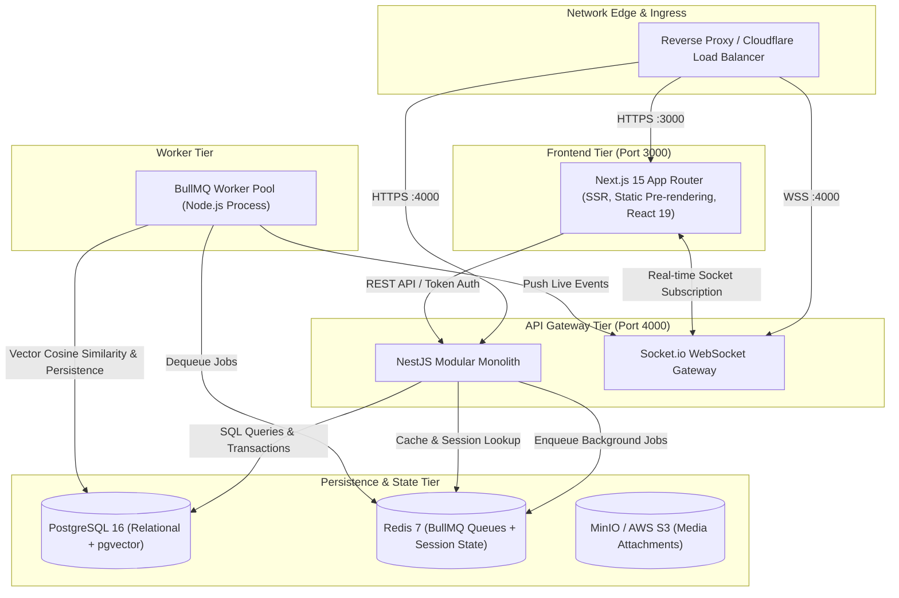
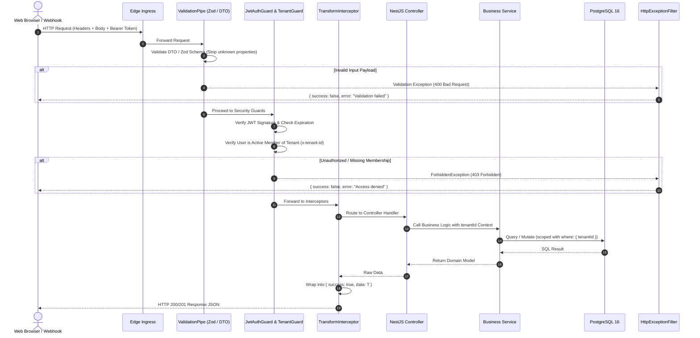
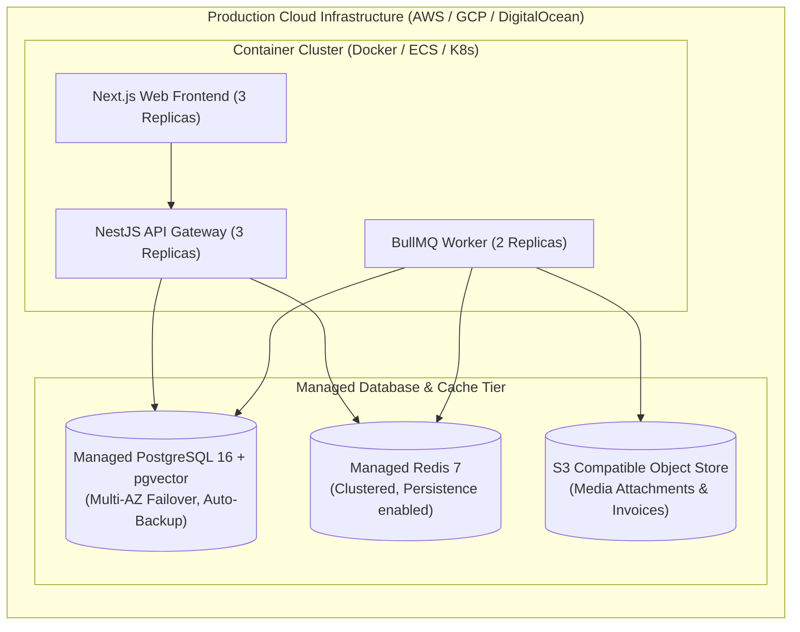

# OmniFlow AI — Master Architecture & Engineering Blueprint

## 1. Executive Summary & System Vision
**OmniFlow AI** is a commercial-grade, multi-tenant AI Business Automation SaaS platform inspired by the capabilities of [AiPraktor](https://www.aipraktor.com/). It enables e-commerce brands, retail stores, and service businesses across Bangladesh and global markets to:
1. **Unify Social Channels**: Aggregate incoming customer conversations from Facebook Messenger, Instagram Direct, WhatsApp Business Cloud API, and embedded web Livechat into a single, high-performance inbox.
2. **Automate Sales & Support with Multimodal AI**: Deploy conversational agents powered by state-of-the-art Large Language Models (LLMs), GPT-4o Vision for customer photo matching, Whisper Speech-to-Text for voice message processing, and Retrieval-Augmented Generation (RAG) using pgvector embeddings.
3. **Streamline Local & International Commerce**: Provide 1-click in-chat order capture, Cash on Delivery (COD) workflows, tokenized digital payments (bKash, Nagad, Stripe), and automated courier parcel booking (Steadfast Courier, Pathao, RedX).
4. **Enforce Strict Multi-Tenant Security**: Guarantee logical data isolation, role-based access control (RBAC), end-to-end credential encryption at rest, and webhook authenticity validation.

---

## 2. System Context & Container Architecture

### 2.1 C4 System Context Diagram

```mermaid
flowchart TB
    subgraph Users["Platform Users & Customers"]
        Customer["Customer (Facebook / Instagram / WhatsApp / Web)"]
        StoreStaff["Store Staff / Agent (Unified Inbox Operator)"]
        StoreAdmin["Store Admin / Owner (Merchant Manager)"]
        SuperAdmin["Platform Super-Admin (SaaS Operator)"]
    end

    subgraph OmniFlow["OmniFlow AI SaaS Platform"]
        WebClient["Web Application (Next.js 15 App Router)"]
        APIGateway["Core API & Real-Time Engine (NestJS 10)"]
        WorkerService["Background Worker Engine (BullMQ + Redis)"]
        Database[("PostgreSQL 16 + pgvector")]
        RedisCache[("Redis 7 (Queues & Cache)")]
        ObjectStorage[("S3 / MinIO Object Storage")]
    end

    subgraph ExternalServices["External APIs & Platforms"]
        MetaGraph["Meta Graph API (Messenger & Instagram)"]
        WhatsAppAPI["WhatsApp Business Cloud API"]
        OpenAIAPI["OpenAI API (GPT-4o, Vision, Whisper, Embeddings)"]
        PaymentGateways["Payment Gateways (bKash, Nagad, Stripe)"]
        CourierLogistics["Courier Logistics (Steadfast, Pathao, RedX)"]
    end

    Customer <-->|Chat / Voice / Photos| MetaGraph
    Customer <-->|Messages / Voice Notes| WhatsAppAPI
    StoreStaff <-->|Manage Chats & Orders| WebClient
    StoreAdmin <-->|Configure AI, Catalog, Couriers| WebClient
    SuperAdmin <-->|Governance & Metric Tracking| WebClient

    WebClient <-->|HTTPS / WSS| APIGateway
    MetaGraph -->|Webhooks / HMAC-SHA256| APIGateway
    WhatsAppAPI -->|Webhooks / HMAC-SHA256| APIGateway

    APIGateway <-->|Read / Write| Database
    APIGateway <-->|Publish Events / Cache| RedisCache
    WorkerService <-->|Consume Jobs| RedisCache
    WorkerService <-->|Persist State| Database
    WorkerService <-->|Store Media Attachments| ObjectStorage

    WorkerService -->|LLM & Vision Calls| OpenAIAPI
    WorkerService -->|Send Outbound Messages| MetaGraph
    WorkerService -->|Send Outbound Messages| WhatsAppAPI
    WorkerService -->|Create Payments & Callbacks| PaymentGateways
    WorkerService -->|Book Consignments & Track| CourierLogistics
```


### 2.2 Container Topology & Runtime Separation


---

## 3. Monorepo Structure & Package Responsibilities

The codebase is organized in an enterprise monorepo using **pnpm workspaces** and **Turborepo**:

```
omniflow-saas/
├── apps/
│   ├── web/                     # Next.js 15, React 19, Tailwind CSS, Lucide, Recharts, i18n
│   ├── api/                     # NestJS 10 Enterprise API, REST, WebSockets, Guards, Swagger
│   └── worker/                  # BullMQ Job Processors, Schedulers, External Sync Workers
├── packages/
│   ├── database/                # Prisma ORM, PostgreSQL schema, migrations, seeders, client
│   ├── shared/                  # Domain Enums, Zod DTO schemas, TypeScript interfaces, i18n
│   ├── ui/                      # Reusable UI component library (Tailwind + Radix primitives)
│   └── integrations/            # Meta Graph API, WhatsApp Cloud, OpenAI, bKash, Nagad, Steadfast
├── docs/                        # Comprehensive Architecture, Database, Security & API docs
├── docker/                      # Docker Compose definitions (PostgreSQL, Redis, MinIO)
└── .agents/                     # Rules, engineering guardrails, security constraints
```

### 3.1 Package Boundary Matrix

| Package / App | Primary Role | Allowed Dependencies | Prohibited Dependencies |
|:---|:---|:---|:---|
| `packages/shared` | Types, Enums, Zod Schemas, i18n dictionaries | `zod` | Must NOT depend on any framework or database |
| `packages/database` | Database access, Prisma client, seeders | `@prisma/client`, `@omniflow/shared` | Must NOT import web or API frameworks |
| `packages/integrations` | External API clients (Meta, OpenAI, bKash, Steadfast) | `axios`, `@omniflow/shared` | Must NOT touch database directly |
| `packages/ui` | Reusable design system React components | `react`, `clsx`, `tailwind-merge`, `lucide-react` | Must NOT contain business logic or API endpoints |
| `apps/api` | REST API, WebSockets, tenant authentication, guards | `@omniflow/*`, `@nestjs/*` | Must NOT run CPU-heavy background tasks |
| `apps/worker` | Async queue processing (AI, Webhooks, Courier sync) | `@omniflow/*`, `bullmq`, `ioredis` | Must NOT expose public HTTP ports |
| `apps/web` | Public site, Merchant Dashboard, Super-Admin UI | `@omniflow/ui`, `@omniflow/shared`, `next` | Must NOT access database directly |

---

## 4. Frontend Architecture (`apps/web`)

### 4.1 Layout Hierarchy & Route Groups
`apps/web` utilizes Next.js 15 App Router with separated route groups for strict layout boundary isolation:
1. **`(marketing)` Group**:
   - Path: `/`
   - Purpose: SEO-optimized, highly responsive public marketing website.
   - Features: Hero value proposition, interactive live AI simulator, pricing tiers (BDT/USD), customer reviews, integration badges.
2. **`(auth)` Group**:
   - Paths: `/login`, `/register`, `/forgot-password`, `/onboarding`
   - Purpose: Clean authentication forms with validation, error states, and workspace provisioning wizard.
3. **`(dashboard)` Group**:
   - Path: `/dashboard/*` (Inbox, AI Agent, Products, Orders, Customers, Knowledge, Workflows, Bookings, Integrations, Billing, Team)
   - Layout: Collapsible navigation sidebar, persistent top bar with workspace switcher dropdown, live AI credit counter pill (`2,480 credits`), notification bell, and language toggle.
4. **`(admin)` Group**:
   - Path: `/admin/*`
   - Layout: Dark-themed, high-security dashboard dedicated to platform operators for global GMV tracking, tenant management, and credit adjustments.

### 4.2 State Management & Real-Time Sync Strategy
- **Authentication & Workspace Context**: `AuthProvider` encapsulates active user profile, JWT token persistence in `localStorage`, and active tenant ID (`x-tenant-id`).
- **Bilingual Localization Context**: `I18nProvider` enables instantaneous language switching between English (`en`) and Bengali (`bn`) with zero layout shift.
- **WebSocket Synchronization**: On entering `/dashboard/inbox`, client connects to `/socket.io` with `tenantId` query parameter, joining tenant room `tenant:{tenantId}`. Active conversation joins room `conversation:{conversationId}` for instantaneous message streaming.

---

## 5. Backend Architecture (`apps/api`)

### 5.1 NestJS Modular Design
`apps/api` implements clean architecture principles structured into focused domain modules:
- **`AuthModule`**: User registration, login, JWT token issuance, refresh token rotation, password hashing with bcrypt (10 rounds).
- **`TenantsModule`**: Workspace provisioning, member invitations, role management (`OWNER`, `ADMIN`, `MANAGER`, `AGENT`).
- **`ChannelsModule`**: Connection life-cycle for Meta Pages, Instagram, WhatsApp Cloud API, and webhook endpoint ingress.
- **`InboxModule`**: Conversation management, message threads, human handover protocol, and Socket.io gateway.
- **`AiAgentModule`**: Agent persona settings, tone, confidence threshold, and interactive query testing.
- **`KnowledgeModule`**: Document ingestion, chunking, and pgvector cosine similarity retrieval.
- **`ProductsModule`**: Product catalog CRUD, image galleries, visual match tags, and inventory decrement.
- **`OrdersModule`**: Order pipeline, server-side idempotency validation, invoice data calculation.
- **`CustomersModule`**: CRM contacts, lead stage pipeline (`NEW` -> `QUALIFIED` -> `WON`), lifetime value tracking.
- **`PaymentsModule`**: bKash Tokenized Checkout, Nagad PG, Stripe Checkout session creation.
- **`CouriersModule`**: Steadfast Courier API dispatch, tracking status synchronization, Pathao and RedX adapters.
- **`BillingModule`**: AI credit transaction ledger, top-up checkout, subscription status check.
- **`AnalyticsModule`**: Store metrics aggregation (Revenue in BDT, AI resolution rate %, response time latency).
- **`SuperAdminModule`**: Platform governance endpoints protected by `SuperAdminGuard`.

### 5.2 Request Lifecycle & Security Pipeline


---

## 6. Background Worker Architecture (`apps/worker`)

### 6.1 BullMQ Queue Topology
Background tasks are decoupled from synchronous HTTP requests using Redis-backed BullMQ queues:
1. **`meta-webhook-queue`**:
   - Ingests incoming Meta/WhatsApp payloads immediately so the webhook HTTP handler can return `200 OK` within Meta's strict 5-second deadline.
   - Concurrency: 10 workers per instance.
2. **`ai-generation-queue`**:
   - Executes multi-turn LLM reasoning, pgvector RAG retrieval, Whisper audio transcription, and GPT-4o Vision analysis.
   - Enforces credit deduction before dispatching outbound messages.
   - Retries: 3 attempts with exponential backoff (`delay: 2000, backoff: { type: 'exponential' }`).
3. **`courier-sync-queue`**:
   - Cron-triggered job running every 15 minutes.
   - Queries Steadfast and Pathao APIs for shipments in status `IN_TRANSIT`.
   - Automatically marks orders as `DELIVERED` or `RETURNED` upon courier confirmation.
4. **`followup-queue`**:
   - Evaluates abandoned customer carts and inactive chats after 120 minutes.
   - Emits compliant follow-up templates inside Meta's 24-hour customer messaging window.

---

## 7. Multi-Tenant Workspace Isolation

### 7.1 Isolation Model
OmniFlow AI employs a **Shared Database, Multi-Tenant Row-Level Logical Segregation** model:
- **Tenant Context Identification**:
  - The client provides the active workspace ID via the `x-tenant-id` HTTP header or authenticated JWT claim.
  - `TenantGuard` executes on every protected route, performing a composite lookup on `WorkspaceMember`:
    ```sql
    SELECT * FROM "WorkspaceMember"
    WHERE "tenantId" = :tenantId AND "userId" = :userId;
    ```
  - If the membership does not exist or user status is suspended, request execution is aborted immediately with `403 Forbidden`.
- **Service Layer Scoping**:
  - Every Prisma query in services explicitly attaches `tenantId`:
    ```typescript
    await prisma.order.findMany({ where: { tenantId } });
    ```
- **Compound Unique Constraints**:
  - Prevents cross-tenant identifier collision:
    - Products: `@@unique([tenantId, sku])`
    - Channels: `@@unique([tenantId, type, externalId])`
    - Orders: `@@unique([tenantId, orderNumber])`
    - Members: `@@unique([tenantId, userId])`

---

## 8. Multimodal AI Agent Execution Pipeline

```mermaid
flowchart TD
    A["Inbound Customer Message (Text / Voice / Image)"] --> B{"Is Handover Active?<br/>(status === HUMAN_HANDOVER)"}
    B -->|Yes| C["Keep AI Silent - Forward Event to Staff Inbox"]
    B -->|No| D{"Check Tenant AI Credits<br/>(creditBalance > 0)"}
    D -->|No Credits| E["Notify Staff: Credits Exhausted - Pause AI"]
    D -->|Credits OK| F{"Examine Content Type"}

    F -->|Voice Message (.ogg / .m4a)| G["Invoke Whisper-1 STT Engine"]
    G --> H["Transcribed Text Saved into Thread"]
    H --> I["Evaluate Handover Keywords"]

    F -->|Product Photo / Screenshot| J["Invoke GPT-4o Vision API"]
    J --> K["Extract Product Category, Colors, Descriptors"]
    K --> L["Match Product in Catalog (SKU / Name)"]
    L --> I

    F -->|Regular Text| I

    I -->|Keyword Match: 'agent', 'প্রতিনিধি'| M["Trigger Human Handover<br/>Update Status to HUMAN_HANDOVER<br/>Send Fallback Notice"]
    I -->|Normal Inquiry| N["Semantic Cosine Similarity Query on pgvector Knowledge Base"]
    N --> O["Retrieve Top-K Relevant Document Chunks"]
    O --> P["Fetch Active Products & Prices in BDT"]
    P --> Q["Assemble Master Prompt with Persona, Tone & Guardrails"]
    Q --> R["Execute OpenAI Chat Completion (GPT-4o)"]
    R --> S["Deduct Tenant Credits & Record Audit Transaction"]
    S --> T["Dispatch Outbound Message via Meta / WhatsApp API"]
    T --> U["Emit Socket Event to Unified Inbox UI"]
```

---

## 9. Deployment & Infrastructure Architecture


