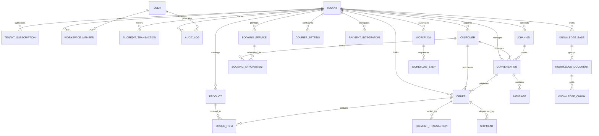

# OmniFlow AI — Database Architecture & Schema Specification

## 1. Database Engine & Extension Specifications
- **Engine**: PostgreSQL 16 (Relational + Document + Vector Extension)
- **ORM / Migrations**: Prisma ORM with version-controlled SQL migrations
- **Vector Extension**: `pgvector` enabled for semantic embeddings:
  ```sql
  CREATE EXTENSION IF NOT EXISTS vector;
  ```
- **Encoding & Collation**: `UTF8` encoding, `C.UTF-8` collation for seamless English, Bengali (বাংলা), and Banglish text storage.

---

## 2. Complete Entity-Relationship Diagram



---

## 3. Complete Prisma PostgreSQL Schema

```prisma
datasource db {
  provider   = "postgresql"
  url        = env("DATABASE_URL")
  extensions = [vector]
}

generator client {
  provider        = "prisma-client-js"
  previewFeatures = ["postgresqlExtensions"]
}

// -------------------------------------------------------------
// Enums
// -------------------------------------------------------------

enum UserStatus {
  ACTIVE
  INACTIVE
  SUSPENDED
  INVITED
}

enum WorkspaceRole {
  OWNER
  ADMIN
  MANAGER
  AGENT
}

enum TenantStatus {
  TRIAL
  ACTIVE
  PAST_DUE
  SUSPENDED
  CANCELLED
}

enum PlanTier {
  STARTER
  GROWTH
  PRO
  ENTERPRISE
}

enum BillingCycle {
  MONTHLY
  YEARLY
}

enum CreditTransactionType {
  SUBSCRIPTION_GRANT
  TOPUP_PURCHASE
  BONUS
  USAGE_CHAT
  USAGE_VISION
  USAGE_VOICE
  USAGE_EMBEDDING
  REFUND
}

enum ChannelType {
  FACEBOOK_PAGE
  INSTAGRAM
  WHATSAPP_BUSINESS
  LIVECHAT
}

enum ChannelStatus {
  CONNECTED
  DISCONNECTED
  EXPIRED
  ERROR
}

enum ConversationStatus {
  OPEN
  BOT_ACTIVE
  HUMAN_HANDOVER
  SNOOZED
  RESOLVED
}

enum Priority {
  LOW
  MEDIUM
  HIGH
  URGENT
}

enum SenderType {
  CUSTOMER
  AGENT
  BOT
  SYSTEM
}

enum MessageContentType {
  TEXT
  IMAGE
  AUDIO
  VIDEO
  FILE
  PRODUCT_CARD
  ORDER_CARD
  TEMPLATE
}

enum DeliveryStatus {
  SENDING
  SENT
  DELIVERED
  READ
  FAILED
}

enum LeadStage {
  NEW
  CONTACTED
  QUALIFIED
  PROPOSAL_SENT
  WON
  LOST
}

enum ProductStatus {
  ACTIVE
  DRAFT
  OUT_OF_STOCK
  ARCHIVED
}

enum OrderStatus {
  PENDING
  CONFIRMED
  PROCESSING
  SHIPPED
  DELIVERED
  CANCELLED
  REFUNDED
}

enum PaymentStatus {
  UNPAID
  PARTIALLY_PAID
  PAID
  REFUNDED
  FAILED
}

enum PaymentMethod {
  COD
  BKASH
  NAGAD
  STRIPE
  SSLCOMMERZ
}

enum PaymentProvider {
  BKASH
  NAGAD
  STRIPE
  SSLCOMMERZ
  MANUAL
}

enum CourierProvider {
  STEADFAST
  PATHAO
  REDX
  MANUAL
}

enum ShipmentStatus {
  PENDING
  ACCEPTED
  PICKED_UP
  IN_TRANSIT
  DELIVERED
  RETURNED
  CANCELLED
}

enum AiTone {
  FRIENDLY
  PROFESSIONAL
  DIRECT
  PERSUASIVE
}

enum AiLanguage {
  AUTO
  BENGALI
  ENGLISH
  BANGLISH
}

enum DocSourceType {
  FAQ
  MANUAL_TEXT
  PDF_FILE
  URL_SCRAPE
}

enum DocStatus {
  PENDING
  PROCESSING
  INDEXED
  FAILED
}

enum WorkflowTriggerType {
  NEW_MESSAGE
  KEYWORD_DETECTED
  ORDER_CREATED
  ORDER_STATUS_CHANGED
  PAYMENT_RECEIVED
  INACTIVITY_TIMEOUT
  HUMAN_HANDOVER_REQUESTED
}

enum WorkflowActionType {
  SEND_MESSAGE
  AI_GENERATE_REPLY
  ASSIGN_AGENT
  ADD_CUSTOMER_TAG
  UPDATE_LEAD_STAGE
  DISPATCH_COURIER_PARCEL
  TRIGGER_WEBHOOK
  WAIT_DELAY
}

enum BookingStatus {
  PENDING
  CONFIRMED
  COMPLETED
  CANCELLED
  NO_SHOW
}

// -------------------------------------------------------------
// Core Multi-Tenant & Identity Models
// -------------------------------------------------------------

model Tenant {
  id              String        @id @default(uuid())
  name            String
  slug            String        @unique
  logo            String?
  currency        String        @default("BDT")
  timezone        String        @default("Asia/Dhaka")
  defaultLanguage String        @default("bn")
  creditBalance   Int           @default(500)
  status          TenantStatus  @default(TRIAL)
  createdAt       DateTime      @default(now())
  updatedAt       DateTime      @updatedAt

  members              WorkspaceMember[]
  subscriptions        TenantSubscription[]
  creditTransactions   AiCreditTransaction[]
  auditLogs            AuditLog[]
  channels             Channel[]
  customers            Customer[]
  conversations        Conversation[]
  messages             Message[]
  aiAgentConfig        AiAgentConfig?
  knowledgeBases       KnowledgeBase[]
  knowledgeDocuments   KnowledgeDocument[]
  knowledgeChunks      KnowledgeChunk[]
  categories           Category[]
  products             Product[]
  orders               Order[]
  courierSettings      CourierSetting[]
  shipments            Shipment[]
  paymentIntegrations  PaymentIntegration[]
  paymentTransactions  PaymentTransaction[]
  workflows            Workflow[]
  bookingServices      BookingService[]
  bookingAppointments  BookingAppointment[]

  @@index([status])
}

model User {
  id            String      @id @default(uuid())
  email         String      @unique
  passwordHash  String
  name          String
  avatarUrl     String?
  phone         String?
  isSuperAdmin  Boolean     @default(false)
  emailVerified Boolean     @default(false)
  status        UserStatus  @default(ACTIVE)
  lastLoginAt   DateTime?
  createdAt     DateTime    @default(now())
  updatedAt     DateTime    @updatedAt

  memberships   WorkspaceMember[]
  auditLogs     AuditLog[]

  @@index([email])
}

model WorkspaceMember {
  id                      String        @id @default(uuid())
  tenantId                String
  userId                  String
  role                    WorkspaceRole @default(AGENT)
  isOnline                Boolean       @default(false)
  activeConversationCount Int           @default(0)
  createdAt               DateTime      @default(now())
  updatedAt               DateTime      @updatedAt

  tenant                  Tenant        @relation(fields: [tenantId], references: [id], onDelete: Cascade)
  user                    User          @relation(fields: [userId], references: [id], onDelete: Cascade)
  assignedConversations   Conversation[]

  @@unique([tenantId, userId])
  @@index([tenantId])
  @@index([userId])
}

model TenantSubscription {
  id                  String             @id @default(uuid())
  tenantId            String
  planTier            PlanTier           @default(STARTER)
  billingCycle        BillingCycle       @default(MONTHLY)
  status              TenantStatus       @default(ACTIVE)
  currentPeriodStart  DateTime           @default(now())
  currentPeriodEnd    DateTime
  stripeSubscriptionId String?
  bkashSubscriptionId  String?
  createdAt           DateTime           @default(now())
  updatedAt           DateTime           @updatedAt

  tenant              Tenant             @relation(fields: [tenantId], references: [id], onDelete: Cascade)

  @@index([tenantId])
}

model AiCreditTransaction {
  id           String                @id @default(uuid())
  tenantId     String
  amount       Int
  type         CreditTransactionType
  balanceAfter Int
  description  String
  metadata     Json?
  createdAt    DateTime              @default(now())

  tenant       Tenant                @relation(fields: [tenantId], references: [id], onDelete: Cascade)

  @@index([tenantId, createdAt])
}

model AuditLog {
  id         String   @id @default(uuid())
  tenantId   String?
  userId     String?
  action     String
  entityType String
  entityId   String?
  details    Json?
  ipAddress  String?
  userAgent  String?
  createdAt  DateTime @default(now())

  tenant     Tenant?  @relation(fields: [tenantId], references: [id], onDelete: Cascade)
  user       User?    @relation(fields: [userId], references: [id], onDelete: SetNull)

  @@index([tenantId, createdAt])
}

// -------------------------------------------------------------
// Omnichannel Messaging Models
// -------------------------------------------------------------

model Channel {
  id                    String        @id @default(uuid())
  tenantId              String
  type                  ChannelType
  name                  String
  externalId            String
  accessTokenEncrypted  String?       @db.Text
  refreshTokenEncrypted String?       @db.Text
  webhookVerifyToken    String?
  status                ChannelStatus @default(CONNECTED)
  config                Json?
  lastSyncedAt          DateTime?
  createdAt             DateTime      @default(now())
  updatedAt             DateTime      @updatedAt

  tenant                Tenant        @relation(fields: [tenantId], references: [id], onDelete: Cascade)
  conversations         Conversation[]
  orders                Order[]

  @@unique([tenantId, type, externalId])
  @@index([tenantId])
}

model Customer {
  id          String      @id @default(uuid())
  tenantId    String
  name        String
  email       String?
  phone       String?
  avatarUrl   String?
  city        String?
  district    String?
  address     String?     @db.Text
  leadStage   LeadStage   @default(NEW)
  tags        Json?
  notes       String?     @db.Text
  totalOrders Int         @default(0)
  totalSpent  Decimal     @default(0.00) @db.Decimal(12, 2)
  createdAt   DateTime    @default(now())
  updatedAt   DateTime    @updatedAt

  tenant              Tenant               @relation(fields: [tenantId], references: [id], onDelete: Cascade)
  conversations       Conversation[]
  orders              Order[]
  bookingAppointments BookingAppointment[]

  @@index([tenantId, phone])
  @@index([tenantId, email])
}

model Conversation {
  id                 String             @id @default(uuid())
  tenantId           String
  channelId          String
  customerId         String
  assignedMemberId   String?
  status             ConversationStatus @default(BOT_ACTIVE)
  priority           Priority           @default(MEDIUM)
  lastMessagePreview String?            @db.Text
  lastMessageAt      DateTime           @default(now())
  unreadCount        Int                @default(0)
  aiAssisted         Boolean            @default(true)
  tags               Json?
  createdAt          DateTime           @default(now())
  updatedAt          DateTime           @updatedAt

  tenant             Tenant             @relation(fields: [tenantId], references: [id], onDelete: Cascade)
  channel            Channel            @relation(fields: [channelId], references: [id], onDelete: Cascade)
  customer           Customer           @relation(fields: [customerId], references: [id], onDelete: Cascade)
  assignedMember     WorkspaceMember?   @relation(fields: [assignedMemberId], references: [id], onDelete: SetNull)
  messages           Message[]
  orders             Order[]
  bookingAppointments BookingAppointment[]

  @@index([tenantId, status])
  @@index([tenantId, lastMessageAt])
  @@index([channelId])
  @@index([customerId])
}

model Message {
  id                String             @id @default(uuid())
  tenantId          String
  conversationId    String
  senderType        SenderType
  senderId          String?
  contentType       MessageContentType @default(TEXT)
  content           String             @db.Text
  mediaUrl          String?            @db.Text
  mediaMetadata     Json?
  externalMessageId String?
  deliveryStatus    DeliveryStatus     @default(SENT)
  aiGenerated       Boolean            @default(false)
  tokensUsed        Int?
  sentiment         String?
  createdAt         DateTime           @default(now())

  tenant            Tenant             @relation(fields: [tenantId], references: [id], onDelete: Cascade)
  conversation      Conversation       @relation(fields: [conversationId], references: [id], onDelete: Cascade)

  @@index([tenantId])
  @@index([conversationId, createdAt])
  @@index([externalMessageId])
}

// -------------------------------------------------------------
// AI Agent, RAG Knowledge Base & pgvector Models
// -------------------------------------------------------------

model AiAgentConfig {
  id                  String     @id @default(uuid())
  tenantId            String     @unique
  personaName         String     @default("OmniAssistant")
  systemPrompt        String     @db.Text
  tone                AiTone     @default(FRIENDLY)
  language            AiLanguage @default(AUTO)
  temperature         Float      @default(0.7)
  confidenceThreshold Float      @default(0.75)
  capabilities        Json
  handoverKeywords    Json
  fallbackMessageEn   String     @db.Text
  fallbackMessageBn   String     @db.Text
  businessHoursOnly   Boolean    @default(false)
  businessHoursJson   Json?
  createdAt           DateTime   @default(now())
  updatedAt           DateTime   @updatedAt

  tenant              Tenant     @relation(fields: [tenantId], references: [id], onDelete: Cascade)
}

model KnowledgeBase {
  id          String              @id @default(uuid())
  tenantId    String
  name        String
  description String?             @db.Text
  createdAt   DateTime            @default(now())
  updatedAt   DateTime            @updatedAt

  tenant      Tenant              @relation(fields: [tenantId], references: [id], onDelete: Cascade)
  documents   KnowledgeDocument[]

  @@index([tenantId])
}

model KnowledgeDocument {
  id              String         @id @default(uuid())
  knowledgeBaseId String
  tenantId        String
  title           String
  sourceType      DocSourceType  @default(FAQ)
  sourceUrl       String?        @db.Text
  status          DocStatus      @default(PENDING)
  chunkCount      Int            @default(0)
  createdAt       DateTime       @default(now())
  updatedAt       DateTime       @updatedAt

  knowledgeBase   KnowledgeBase  @relation(fields: [knowledgeBaseId], references: [id], onDelete: Cascade)
  tenant          Tenant         @relation(fields: [tenantId], references: [id], onDelete: Cascade)
  chunks          KnowledgeChunk[]

  @@index([knowledgeBaseId])
  @@index([tenantId])
}

model KnowledgeChunk {
  id         String                                  @id @default(uuid())
  documentId String
  tenantId   String
  content    String                                  @db.Text
  // pgvector 1536-dimensional embedding vector (text-embedding-3-small)
  embedding  Unsupported("vector(1536)")
  tokenCount Int                                     @default(0)
  createdAt  DateTime                                @default(now())

  document   KnowledgeDocument                       @relation(fields: [documentId], references: [id], onDelete: Cascade)
  tenant     Tenant                                  @relation(fields: [tenantId], references: [id], onDelete: Cascade)

  @@index([documentId])
  @@index([tenantId])
}

// -------------------------------------------------------------
// E-Commerce, Catalog, Orders & Delivery Models
// -------------------------------------------------------------

model Category {
  id          String    @id @default(uuid())
  tenantId    String
  name        String
  slug        String
  description String?   @db.Text
  createdAt   DateTime  @default(now())
  updatedAt   DateTime  @updatedAt

  tenant      Tenant    @relation(fields: [tenantId], references: [id], onDelete: Cascade)
  products    Product[]

  @@unique([tenantId, slug])
}

model Product {
  id             String        @id @default(uuid())
  tenantId       String
  categoryId     String?
  name           String
  sku            String
  description    String?       @db.Text
  price          Decimal       @db.Decimal(12, 2)
  compareAtPrice Decimal?      @db.Decimal(12, 2)
  costPrice      Decimal?      @db.Decimal(12, 2)
  stockQuantity  Int           @default(0)
  images         Json
  visualTags     Json?
  status         ProductStatus @default(ACTIVE)
  createdAt      DateTime      @default(now())
  updatedAt      DateTime      @updatedAt

  tenant         Tenant        @relation(fields: [tenantId], references: [id], onDelete: Cascade)
  category       Category?     @relation(fields: [categoryId], references: [id], onDelete: SetNull)
  orderItems     OrderItem[]

  @@unique([tenantId, sku])
  @@index([tenantId, status])
}

model Order {
  id                 String        @id @default(uuid())
  tenantId           String
  orderNumber        String
  customerId         String
  conversationId     String?
  channelId          String?
  status             OrderStatus   @default(PENDING)
  subtotal           Decimal       @db.Decimal(12, 2)
  shippingCost       Decimal       @default(0.00) @db.Decimal(12, 2)
  discount           Decimal       @default(0.00) @db.Decimal(12, 2)
  totalAmount        Decimal       @db.Decimal(12, 2)
  currency           String        @default("BDT")
  paymentStatus      PaymentStatus @default(UNPAID)
  paymentMethod      PaymentMethod @default(COD)
  shippingAddress    Json
  notes              String?       @db.Text
  idempotencyKey     String?       @unique
  courierName        String?
  courierTrackingId  String?
  createdAt          DateTime      @default(now())
  updatedAt          DateTime      @updatedAt

  tenant             Tenant        @relation(fields: [tenantId], references: [id], onDelete: Cascade)
  customer           Customer      @relation(fields: [customerId], references: [id], onDelete: Cascade)
  conversation       Conversation? @relation(fields: [conversationId], references: [id], onDelete: SetNull)
  channel            Channel?      @relation(fields: [channelId], references: [id], onDelete: SetNull)
  items              OrderItem[]
  shipments          Shipment[]
  transactions       PaymentTransaction[]

  @@unique([tenantId, orderNumber])
  @@index([tenantId, status])
  @@index([customerId])
}

model OrderItem {
  id          String   @id @default(uuid())
  orderId     String
  productId   String
  productName String
  unitPrice   Decimal  @db.Decimal(12, 2)
  quantity    Int      @default(1)
  totalPrice  Decimal  @db.Decimal(12, 2)

  order       Order    @relation(fields: [orderId], references: [id], onDelete: Cascade)
  product     Product  @relation(fields: [productId], references: [id], onDelete: Restrict)

  @@index([orderId])
}

model CourierSetting {
  id                 String          @id @default(uuid())
  tenantId           String
  provider           CourierProvider
  apiKeyEncrypted    String          @db.Text
  secretKeyEncrypted String?         @db.Text
  isActive           Boolean         @default(true)
  isDefault          Boolean         @default(false)
  createdAt          DateTime        @default(now())
  updatedAt          DateTime        @updatedAt

  tenant             Tenant          @relation(fields: [tenantId], references: [id], onDelete: Cascade)

  @@index([tenantId])
}

model Shipment {
  id             String          @id @default(uuid())
  tenantId       String
  orderId        String
  courier        CourierProvider
  consignmentId  String?
  trackingCode   String?
  status         ShipmentStatus  @default(PENDING)
  pickupAddress  Json?
  deliveryFee    Decimal         @default(0.00) @db.Decimal(12, 2)
  codAmount      Decimal         @default(0.00) @db.Decimal(12, 2)
  rawResponse    Json?
  createdAt      DateTime        @default(now())
  updatedAt      DateTime        @updatedAt

  tenant         Tenant          @relation(fields: [tenantId], references: [id], onDelete: Cascade)
  order          Order           @relation(fields: [orderId], references: [id], onDelete: Cascade)

  @@index([tenantId])
  @@index([orderId])
}

model PaymentIntegration {
  id                 String          @id @default(uuid())
  tenantId           String
  provider           PaymentProvider
  merchantId         String?
  apiKeyEncrypted    String          @db.Text
  secretKeyEncrypted String          @db.Text
  isActive           Boolean         @default(true)
  isSandbox          Boolean         @default(true)
  createdAt          DateTime        @default(now())
  updatedAt          DateTime        @updatedAt

  tenant             Tenant          @relation(fields: [tenantId], references: [id], onDelete: Cascade)

  @@index([tenantId])
}

model PaymentTransaction {
  id               String          @id @default(uuid())
  tenantId         String
  orderId          String
  provider         PaymentProvider
  transactionId    String
  amount           Decimal         @db.Decimal(12, 2)
  currency         String          @default("BDT")
  status           PaymentStatus   @default(UNPAID)
  providerResponse Json?
  verifiedAt       DateTime?
  createdAt        DateTime        @default(now())

  tenant           Tenant          @relation(fields: [tenantId], references: [id], onDelete: Cascade)
  order            Order           @relation(fields: [orderId], references: [id], onDelete: Cascade)

  @@index([tenantId])
  @@index([orderId])
  @@index([transactionId])
}

// -------------------------------------------------------------
// Workflows & Appointments
// -------------------------------------------------------------

model Workflow {
  id            String              @id @default(uuid())
  tenantId      String
  name          String
  description   String?             @db.Text
  triggerType   WorkflowTriggerType
  triggerConfig Json
  isActive      Boolean             @default(true)
  createdAt     DateTime            @default(now())
  updatedAt     DateTime            @updatedAt

  tenant        Tenant              @relation(fields: [tenantId], references: [id], onDelete: Cascade)
  steps         WorkflowStep[]

  @@index([tenantId])
}

model WorkflowStep {
  id           String             @id @default(uuid())
  workflowId   String
  stepOrder    Int
  actionType   WorkflowActionType
  actionConfig Json

  workflow     Workflow           @relation(fields: [workflowId], references: [id], onDelete: Cascade)

  @@index([workflowId])
}

model BookingService {
  id              String               @id @default(uuid())
  tenantId        String
  name            String
  description     String?              @db.Text
  durationMinutes Int                  @default(30)
  price           Decimal              @default(0.00) @db.Decimal(12, 2)
  isActive        Boolean              @default(true)
  createdAt       DateTime             @default(now())
  updatedAt       DateTime             @updatedAt

  tenant          Tenant               @relation(fields: [tenantId], references: [id], onDelete: Cascade)
  appointments    BookingAppointment[]

  @@index([tenantId])
}

model BookingAppointment {
  id                 String         @id @default(uuid())
  tenantId           String
  serviceId          String
  customerId         String
  conversationId     String?
  scheduledStartTime DateTime
  scheduledEndTime   DateTime
  status             BookingStatus  @default(PENDING)
  customerNotes      String?        @db.Text
  createdAt          DateTime       @default(now())
  updatedAt          DateTime       @updatedAt

  tenant             Tenant         @relation(fields: [tenantId], references: [id], onDelete: Cascade)
  service            BookingService @relation(fields: [serviceId], references: [id], onDelete: Cascade)
  customer           Customer       @relation(fields: [customerId], references: [id], onDelete: Cascade)
  conversation       Conversation?  @relation(fields: [conversationId], references: [id], onDelete: SetNull)

  @@index([tenantId, scheduledStartTime])
  @@index([customerId])
}
```

---

## 4. Vector Search Indexing (`pgvector`)

For fast approximate nearest neighbor (ANN) search over knowledge chunks:
```sql
-- Hierarchical Navigable Small World (HNSW) Index on KnowledgeChunk embedding vector
CREATE INDEX IF NOT EXISTS "idx_knowledge_chunk_embedding_hnsw"
ON "KnowledgeChunk"
USING hnsw (embedding vector_cosine_ops)
WITH (m = 16, ef_construction = 64);
```

### Semantic Cosine Similarity Query:
```sql
SELECT
  id,
  content,
  1 - (embedding <=> :queryVector) AS similarity
FROM "KnowledgeChunk"
WHERE "tenantId" = :tenantId
ORDER BY embedding <=> :queryVector
LIMIT 3;
```
