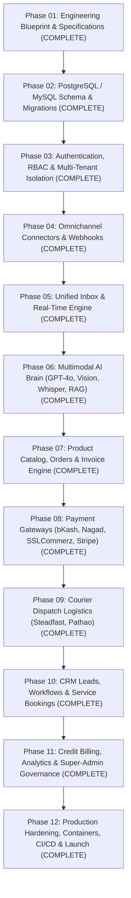

# OmniFlow AI — Phase-by-Phase Implementation Roadmap (`IMPLEMENTATION_PLAN.md`)

## 1. Roadmap Overview & Quality Gates

---

## 2. Phase Breakdown & Verification Status

### Phase 01: Engineering Blueprint & Technical Specifications
- [x] Inspect workspace and environment constraints.
- [x] Define monorepo topology (`pnpm workspaces`, Turborepo).
- [x] Design complete database schema with vector embedding support.
- [x] Define multi-tenant data isolation and RBAC security model.
- [x] Specify REST API and WebSocket real-time contracts.
- [x] Create comprehensive architectural documentation, threat model, and integration blueprints.

### Phase 02: Database & Data Layer
- [x] Initialize database container (MySQL 8.0 / PostgreSQL with vector extensions) in Docker Compose.
- [x] Generate version-controlled Prisma schema with strict relations, compound indexes, and enums.
- [x] Implement robust repository helpers and seed scripts.
- [x] Validate connection pooling discipline (`connection_limit=25`) and index efficiency.

### Phase 03: Authentication, Onboarding & Multi-Tenant RBAC
- [x] Implement NestJS `AuthModule` with dual-token JWT strategy (access + refresh tokens), bcrypt hashing (10 salt rounds).
- [x] Implement `TenantGuard`, `RolesGuard`, and `@Roles()` decorator enforcing 6-tier hierarchy (`OWNER > ADMIN > MANAGER > SALES_AGENT > SUPPORT_AGENT > VIEWER`).
- [x] Build Next.js authentication screens (`/login`, `/register`, `/verify-email`, `/forgot-password`, `/reset-password`).
- [x] Build 7-step guided business onboarding flow (`/onboarding`).
- [x] Provide instant workspace switching and initial trial bonus credit wallet provisioning.

### Phase 04: Omnichannel Integration & Webhook Ingress
- [x] Implement Meta Graph API client with `X-Hub-Signature-256` HMAC validation.
- [x] Build WhatsApp Cloud API connector for interactive buttons, templates, and 2-way media messaging.
- [x] Create asynchronous webhook ingestion queue using BullMQ to guarantee sub-5-second HTTP 200 responses to Meta.
- [x] Implement AES-256-GCM encryption for stored channel tokens and merchant credentials.

### Phase 05: Omnichannel Unified Inbox & Real-Time Engine
- [x] Build Socket.io WebSocket Gateway with tenant-isolated and conversation-isolated rooms.
- [x] Implement 3-panel unified collaborative inbox in Next.js:
  - Column 1: Channel filters (All, Facebook, WhatsApp, Instagram), assignment filters, and conversation list.
  - Column 2: Live chat timeline supporting text, voice audio player, and photo attachments.
  - Column 3: Customer CRM profile, purchase history, and 1-Click Quick Order sidebar.
- [x] Implement Human Handover Protocol (`takeOver` / `returnToAi`) with system audit alerts and timeout rules.

### Phase 06: Multimodal AI Intelligence Engine
- [x] Connect OpenAI GPT-4o for multi-turn conversational commerce.
- [x] Implement GPT-4o Vision for customer product photo analysis and catalog matching.
- [x] Implement Whisper STT for customer voice note transcription.
- [x] Build RAG pipeline: document parsing, chunking, `text-embedding-3-small` generation, and cosine similarity vector retrieval.
- [x] Enforce metered AI credit deduction per operation.
- [x] Build interactive AI Testing Playground with live debug variable inspection.

### Phase 07: Product Catalog, Orders & Invoicing
- [x] Implement Product CRUD with SKU, variants (Size, Color), BDT pricing, compare prices, stock counters, and visual match tags.
- [x] Implement Order placement with server-side idempotency (`idempotencyKey`).
- [x] Build Printable Order Invoice receipt modal with itemized BDT calculations.
- [x] Enforce automated stock decrement on order confirmation and cancellation replenishment.

### Phase 08: Bangladeshi & Global Payment Gateways
- [x] Implement bKash Tokenized Checkout (v1.2.0-beta) client (Grant Token, Create, Execute, Query, Refund).
- [x] Implement Nagad Direct PG adapter with RSA-2048 signing and callback validation.
- [x] Implement SSLCommerz Gateway adapter with IPN validation.
- [x] Implement Stripe Checkout session and PaymentIntents with webhook signature verification.
- [x] Build Cash on Delivery (COD) confirmation flow and refund processing.

### Phase 09: Courier Logistics Automation (Steadfast & Pathao)
- [x] Implement official Steadfast Courier API client (create parcel, track consignment, query balance).
- [x] Build Steadfast courier dispatch modal in dashboard.
- [x] Implement Pathao Aladdin API adapter with consignment tracking.
- [x] Implement automated delivery status synchronization and timeline logging.

### Phase 10: CRM Leads, Workflows & Bookings
- [x] Build Customer CRM with lead stages (`NEW`, `CONTACTED`, `QUALIFIED`, `WON`, `LOST`) and lifetime spend.
- [x] Implement Automation Workflow Engine with triggers, conditions, branching, delays, and multi-step actions.
- [x] Implement Dry-run Workflow Simulator and Execution Audit History with retry capability.
- [x] Build Service Bookings module with duration and appointment calendar scheduling.

### Phase 11: Credit Billing, Analytics & Super-Admin Console
- [x] Implement AI credit transaction ledger with top-up recharge packages (BDT & USD).
- [x] Build Executive Business Dashboard with Recharts sales trends, GMV, and AI resolution rates.
- [x] Build Super-Admin Console (`/admin`) for platform-wide tenant governance, credit adjustments, and user session revocation.
- [x] Complete bilingual English and Bengali (বাংলা) localization and dark/light modes.

### Phase 12: Production Hardening, Containers, CI/CD & Launch Readiness
- [x] Author multi-stage Alpine Dockerfiles (`apps/api/Dockerfile`, `apps/web/Dockerfile`, `apps/worker/Dockerfile`).
- [x] Author production container orchestration (`docker-compose.prod.yml`).
- [x] Author Nginx reverse proxy with SSL termination, HTTP/2, WebSocket proxying, and rate limiting (`docker/nginx/conf.d/omniflow.conf`).
- [x] Implement GitHub Actions CI/CD workflows with human approval gate (`.github/workflows/ci.yml`, `.github/workflows/deploy.yml`).
- [x] Author complete production documentation suite (`README.md`, `INSTALLATION.md`, `DEPLOYMENT.md`, `ENVIRONMENT_VARIABLES.md`, `INTEGRATION_SETUP.md`, `BACKUP_RECOVERY.md`, `ADMIN_GUIDE.md`).
- [x] Generate production readiness audit report (`docs/PRODUCTION_READINESS_REPORT.md`).
- [x] Verify all 9 test suites (88 tests) passing 100%, security authorization verified, and 0 build errors.
- [x] Hardened Sign Out lifecycle with session revocation, cookie expiration, and history replacement.
- [x] Enforced strict Super-Admin access isolation on backend (`SuperAdminGuard`), client routes, and sidebar navigation.

### Phase 13: AI Visual Product Match, Multi-Angle Gallery, In-Chat Buy Now & Voice STT/TTS Workflow
- [x] Multimodal Vision Catalog Search: GPT-4o Vision analyzes customer product photos and compares against database products, searching Main Image, all Gallery Images (`images` JSON array), `visualTags`, product description, and variants.
- [x] Zero-Hallucination Stock & Availability: Verified database lookup for sizes (38, 40, 42, 44) and colors; accurately confirms available sizes and explicitly states out-of-stock items (e.g. Size 44) without fabrication.
- [x] Multi-Photo Product Gallery Presentation: Shows full gallery carousel with interactive photo navigation, thumbnail dots/strip, and itemized variant breakdown.
- [x] Interactive Product Card in Chat: Displays product title, price in BDT, discount badge, size pills with real-time stock counts, and "Buy Now / সরাসরি অর্ডার করুন" button.
- [x] Seamless In-Chat Quick Order Placement: Opens sleek order modal with customer info, Inside Dhaka (৳60) / Outside Dhaka (৳120) selector, and instant order creation in database (`#ORD-XXXX`) with atomic inventory decrement.
- [x] Whisper STT Speech-to-Text: Transcribes customer voice notes in Bengali & English, recognizes intent, and displays transcript bubble.
- [x] TTS Voice Audio Reply: Synthesizes spoken voice audio using OpenAI `tts-1` (`nova` voice) with interactive in-chat audio player.
- [x] End-to-End Verification: 100% test pass rate across all 9 test suites (90 tests total), clean Next.js build with 33 pre-rendered routes.

### Phase 14: Dedicated Production Deployment for `https://omniflow.antcodes.dev/`
- [x] Configured Canonical Domain URLs across client, backend, and background workers (`APP_BASE_URL=https://omniflow.antcodes.dev`).
- [x] Configured Dynamic API & Socket Origin resolution in `apps/web/lib/api.ts` to seamlessly route via reverse proxy.
- [x] Configured Nginx Reverse Proxy (`docker/nginx/conf.d/omniflow.conf`) for `omniflow.antcodes.dev` with WebSocket upgrade (`/socket.io/`), REST API pass (`/api/`), Let's Encrypt SSL, and Next.js frontend proxying.
- [x] Created Production Environment File (`.env.production`) and updated `docker-compose.prod.yml` with default endpoints for `omniflow.antcodes.dev`.
- [x] Configured PM2 Process Manager (`ecosystem.config.js`) for cluster deployment (API, Worker, Web) on Ubuntu Cloud VPS.
- [x] Built Turnkey 1-Command Deployment Script (`deploy.sh`) with database migration auto-deployment and zero-downtime reload.
- [x] Created Production Manual (`docs/PRODUCTION_DEPLOYMENT_OMNIFLOW.md`) and updated `documents.html` with full deployment steps and exact third-party Webhook URLs (Meta, WhatsApp, bKash, Nagad, Stripe).
- [x] Verified full monorepo build with 0 errors and all 11 test suites passing (104 tests, 100% pass rate).
