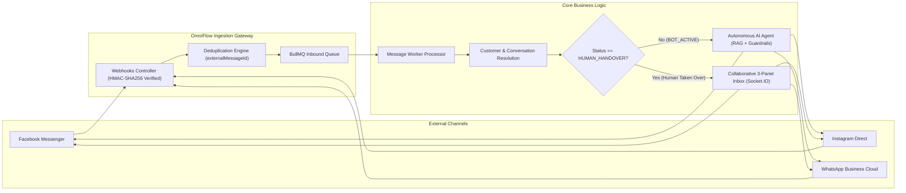
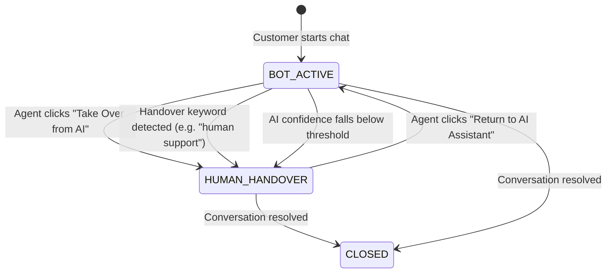

# OmniFlow SaaS — Omnichannel Messaging Integrations Blueprint

This technical specification details the production architecture, configuration workflows, security mechanisms, and operational procedures for connecting **Facebook Messenger**, **Instagram Direct**, and **WhatsApp Business Cloud API** to the OmniFlow SaaS platform.

---

## 1. Omnichannel Messaging Architecture

---

## 2. Meta (Facebook Messenger & Instagram Direct) Integration

### 2.1 Meta Developer App Configuration
1. Navigate to the **Meta for Developers** portal ([developers.facebook.com](https://developers.facebook.com/)).
2. Create a Business App type and add **Messenger** and **Instagram** products.
3. Configure the following official Meta Graph API permissions:
   - `pages_show_list`: Discovers Facebook Pages managed by the merchant.
   - `pages_read_engagement`: Reads page info and customer public profiles.
   - `pages_manage_metadata`: Subscribes OmniFlow app to page webhook events.
   - `pages_messaging`: Sends and receives messages on behalf of the Facebook Page.
   - `instagram_basic`: Accesses Instagram Professional/Business account.
   - `instagram_manage_messages`: Sends and receives direct messages on Instagram.
   - `business_management`: Allows managing connected merchant assets.

### 2.2 Webhook Subscription Configuration
- **Callback URL**: `https://api.yourdomain.com/api/v1/webhooks/meta`
- **Verify Token**: Configured in environment as `META_VERIFY_TOKEN` (default: `omniflow_webhook_verify_token_2026`).
- **Subscribed Fields**:
  - `messages`: Captures inbound text, attachments, quick replies.
  - `messaging_postbacks`: Captures button clicks.
  - `message_deliveries`: Updates message delivery statuses (`DELIVERED`).
  - `message_reads`: Updates read watermarks (`READ`).

### 2.3 Cryptographic Signature Verification
Every inbound Meta webhook includes the `X-Hub-Signature-256` header. OmniFlow verifies this using HMAC-SHA256 with timing-safe comparison:
$$\text{Expected Hash} = \text{HMAC-SHA256}(\text{rawBody}, \text{META\_APP\_SECRET})$$

---

## 3. WhatsApp Business Cloud API Integration

### 3.1 WhatsApp Cloud API Architecture
OmniFlow connects directly to the official **WhatsApp Business Platform Cloud API** hosted by Meta:
1. **Business Account ID (WABA ID)**: Identifies the WhatsApp Business Portfolio.
2. **Phone Number ID**: Identifies the sender phone endpoint.
3. **Permanent System User Token**: Generated via Meta Business Manager with permissions:
   - `whatsapp_business_messaging`
   - `whatsapp_business_management`

### 3.2 Webhook Setup
- **Callback URL**: `https://api.yourdomain.com/api/v1/webhooks/whatsapp`
- **Verify Token**: Configured as `WHATSAPP_VERIFY_TOKEN`.
- **Subscribed Fields**: `messages`.

### 3.3 Outbound Message Types Supported
- **Text Messages**: Plain or formatted customer support text.
- **Media Messages**: Product catalog images, voice notes, invoice PDFs.
- **Interactive Button Messages**: Quick response options (e.g., "Confirm Order", "COD Inside Dhaka").
- **Approved Template Messages**: For outbound re-engagement beyond the 24-hour customer care window.

---

## 4. Reliability & Idempotency Engineering

1. **Idempotent Ingestion**:
   - Meta assigns a unique `mid` to Messenger/Instagram messages.
   - WhatsApp assigns a unique `wamid` to messages.
   - The `Message` table enforces deduplication on `(tenantId, externalMessageId)`. If a retransmitted webhook payload arrives, OmniFlow skips reprocessing immediately.
2. **Fast Acknowledgment (< 50ms)**:
   - Webhook controller responds `HTTP 200 { status: 'EVENT_RECEIVED' }` immediately to prevent webhook timeouts or retries from Meta.
3. **Dead-Letter Queue (DLQ)**:
   - Failed background deliveries retry 3 times with exponential backoff before routing to DLQ for administrator inspection.
4. **Token Security**:
   - All access tokens and credentials stored in the `Channel` table are encrypted at rest using **AES-256-GCM** via `@omniflow/integrations`.

---

## 5. Human Handover Protocol

### Protocol Rules:
1. **AI Reply Suppression**: When `conversation.status === HUMAN_HANDOVER` or `aiAssisted === false`, all autonomous AI generation is strictly paused.
2. **Internal Team Notes**: Team members can toggle **Internal Note** in the reply composer to post private team instructions. Internal notes have `isInternal: true` and are **never transmitted** to the external customer.
3. **Audit History**: Every state transition generates a system notification message recording the event timestamp.
